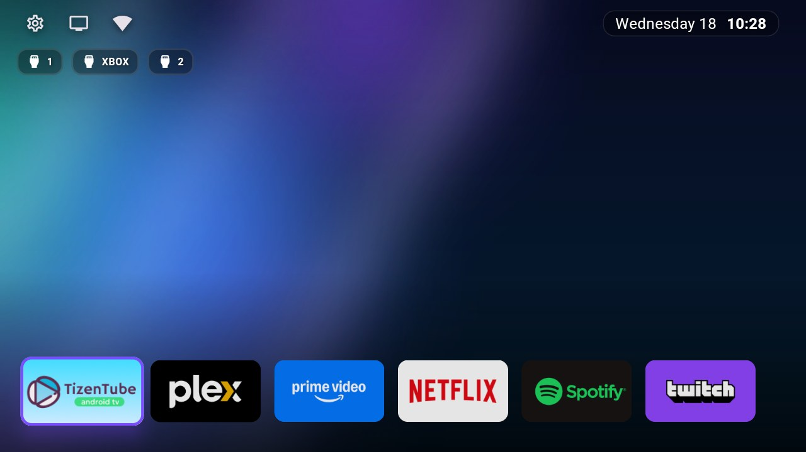
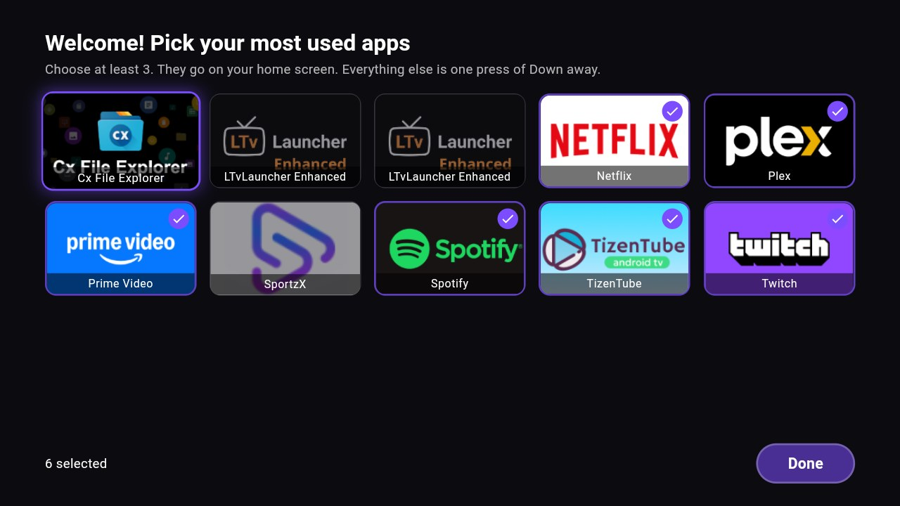
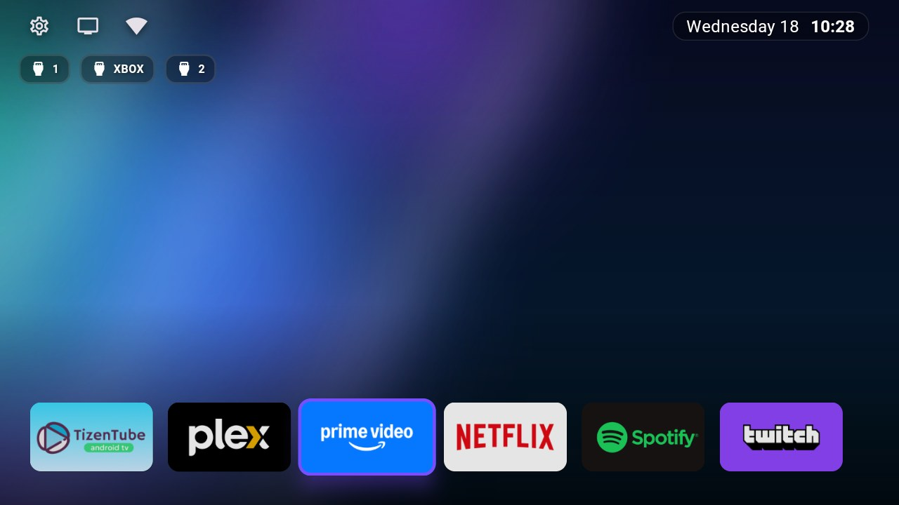
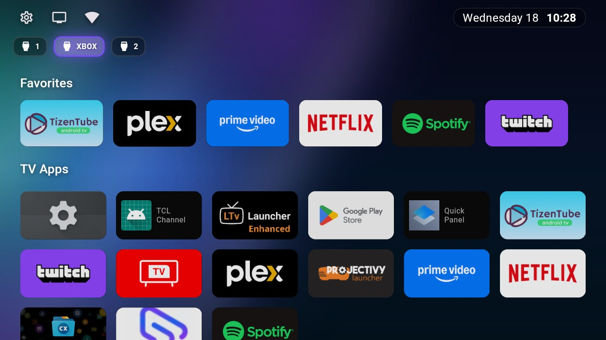
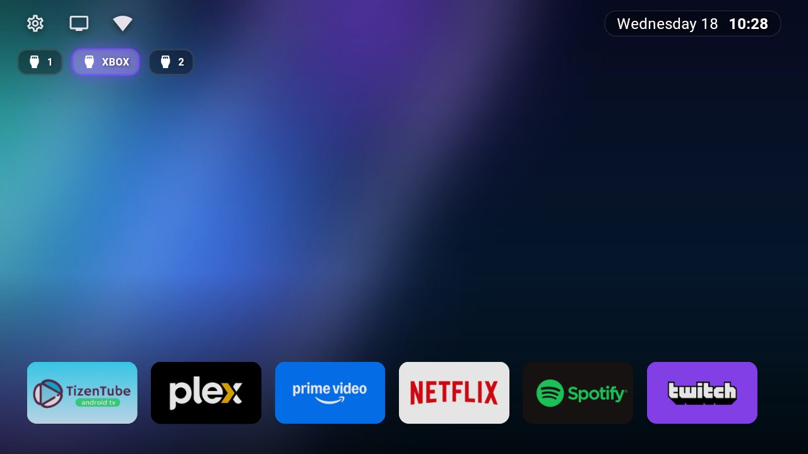
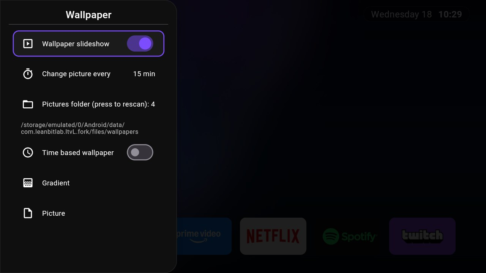
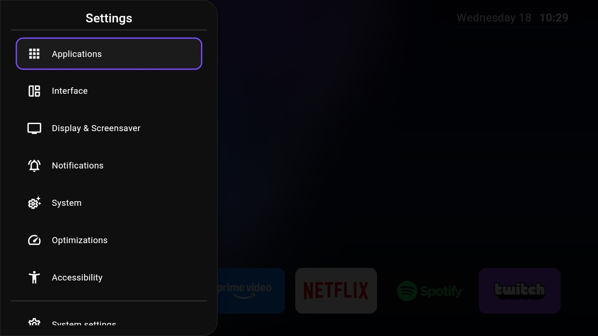
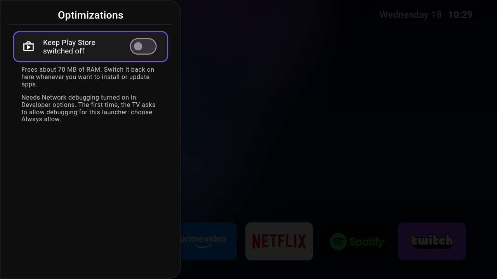
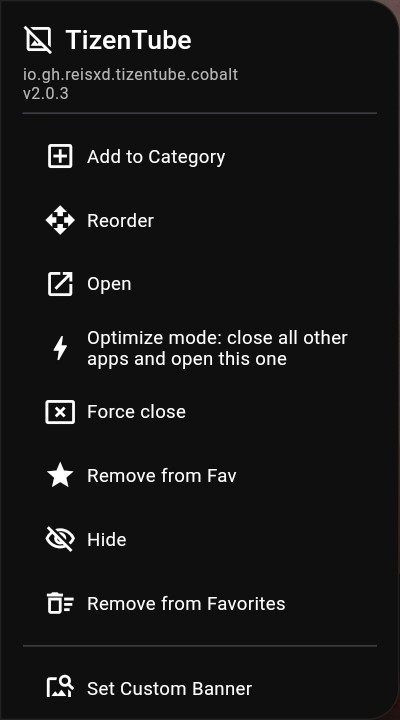

<div align="center">


# LTvLauncher Enhanced

**A wallpaper-first home screen for Android TV: your pictures on show, your favorite apps in one row, nothing else in the way.**

[](LICENSE)


</div>

<p align="center">
  
</p>

LTvLauncher Enhanced is a personal fork of [LTvLauncher](https://github.com/leanbitlab-org/LtvLauncher), which is itself a fork of [FLauncher](https://gitlab.com/flauncher/flauncher). It was built and tuned on a low-end 1 GB TCL Google TV, where every megabyte and every frame matters.

Everything the original does still works: categories, Continue Watching, weather, notifications, themes, backups. This fork **revamps the home screen**, adds a set of **optimizations** for low-RAM TVs, and adds several features the original does not have.

Screenshots use wallpapers generated for this README.

## At a glance: original vs Enhanced

| | LTvLauncher (original) | LTvLauncher Enhanced |
|---|---|---|
| **Home screen** | Rows and grids of apps fill the screen; the wallpaper is mostly hidden | **Showcase layout**: the wallpaper fills the screen with one row of favorites along the bottom. Down opens all apps, Back returns |
| **Wallpaper** | One picture, or one day and one night picture; plain black until you set one | **Slideshow** from a folder of your pictures with a crossfade and a choice of interval (1 minute to 24 hours), and **built-in wallpapers** so a fresh install is never black |
| **Wallpaper memory** | Picture decoded at its full size | Decoded at the **screen width**, so a 4K picture costs no more than a 720p one |
| **Wallpaper timers** | n/a | Slideshow **pauses while another app is in front** (no timer, no decoding) |
| **First run** | Everything is dumped on the home screen | A **welcome screen** asks you to pick at least 3 favorite apps first, so the home screen only has what you use |
| **Favorites** | Empty until you add apps | **Prefilled** with TizenTube, Plex, Prime Video, Netflix, Spotify and Twitch, only those you have installed |
| **HDMI inputs** | A TV icon that opens a list | Small **rounded HDMI chips** under the settings icons, one press to switch, using your TV's own input names |
| **Card style** | Default theme with small corner radius; the highlight only appears after the first key press | **Rounded Glow cards** by default, highlight visible from the first moment |
| **App options (long press)** | Add, open, hide, remove, uninstall | Adds **Force close** and **Optimize mode** (close every other running app, then open this one) |
| **Play Store** | Always running in the background | **Optimizations menu** with a switch to keep it off and back on in about three seconds |
| **Branding** | Purple logo | **Orange logo and banner**, installs as a separate app next to the original |
| **Minimalist mode** | n/a | Optional: only the wallpaper shows, the controls appear on an arrow key press and fade away after a minute |
| **Messages** | n/a | Small themed pill in the top right that fades after 2 seconds |
| **Updates** | Reinstall by hand | Checks GitHub once a day and shows a banner with **Update**, **Ignore** and **Never show updates**; installs silently over the existing app |
| **Donate menu** | Support and Donate entry with QR codes | Removed (and the QR code library with it) |
| **Tests** | Existing suite | Existing suite plus new tests for the slideshow, showcase layout, favorites, HDMI chips and Optimizations |

## First-run setup

A new install does not fill the home screen with every app on the TV. It opens a welcome screen where you pick your most used apps (at least 3). The well known streaming apps you have installed start ticked, you can untick or add others, and **Done** stays greyed out until you have chosen enough. Your choice becomes the Favorites row, in the order you picked. You can run it again any time from Settings, **Choose favorite apps**.

<p align="center">
  
</p>

## Revamped UI

### Showcase home screen
The wallpaper fills the screen and your favorite apps sit in a single row along the bottom. The only other things on screen are the settings icons, the HDMI shortcuts and the clock. Press **Down** to open the full apps view (all categories) and **Back** to return. The wallpaper overlay is lighter in showcase mode, so the picture stays bright and only the bottom edge is darkened behind the apps. Prefer the classic layout? It is one switch away in Settings, Interface, Miscellaneous.

<p align="center">
  
  
</p>

### Minimalist mode
An optional mode for people who want nothing but the picture. Only the wallpaper (undimmed) is shown. Press an arrow key or Select and the controls fade in; the first press only wakes them, so nothing is moved or launched by accident. After a minute without a key press they fade away again. Switch it on in Settings, Interface, Miscellaneous.

### Rounded Glow cards
App cards are rounded and glow in the accent color when focused. The focus highlight is visible from the first moment, so you always know where you are before touching the remote. Six cards fit in the row on a 1280x720 interface.

### HDMI input shortcuts
Small rounded chips under the settings icons switch the TV straight to HDMI 1, HDMI 2 and the rest, using the names your TV gives them (for example "XBOX"). They share the glow and rounded corners of the app cards, and you can reach them with Down from the settings icons. They can be switched off in Miscellaneous.

<p align="center">
  
</p>

### Wallpaper slideshow
Copy pictures into the launcher's wallpaper folder and they rotate on the home screen with a soft crossfade. Choose how often the picture changes: every 1, 5, 15, 30 or 60 minutes, or every 3, 12 or 24 hours (15 minutes by default). Press the folder entry in the settings to rescan after adding pictures. Until you add pictures (or pick a gradient or a single picture yourself) four built-in wallpapers rotate instead, so a fresh install is never plain black.

<p align="center">
  
</p>

### Favorites that adapt to what you have installed
TizenTube, Plex, Prime Video, Netflix, Spotify and Twitch are placed in Favorites automatically, in that order, **only if they are installed**. Anything missing is simply not shown, and it appears the moment you install it. If you remove one from Favorites it stays removed. On a fresh install the Favorites row is the first section.

### Identity
An orange logo and banner make it easy to tell apart from the original on the home screen, and it installs as its own app (`com.leanbitlab.ltvL.fork`) next to the original. The Support and Donate menu entry is gone.

<p align="center">
  
</p>

## Optimizations

### Built into the launcher
- **Screen-width decoding**: wallpapers are decoded no wider than the screen, so a 4K picture does not cost 4K worth of RAM on a 720p TV.
- **Nothing runs in the background for the slideshow**: the timer and the decoding stop while another app is in front, and resume when you come back (switching the picture straight away if it is due).
- **One picture in memory**: the previous wallpaper is evicted from the image cache as soon as the next one is shown.
- **Idle at 0% CPU**: the launcher does no work while you are not touching it (measured below).

### The Optimizations menu
For low-RAM TVs. Right now it has one switch: **keep the Play Store switched off**. The Play Store runs two background processes that use tens of megabytes on a 1 GB TV. Switch it off here, and back on whenever you want to install or update apps. Each change takes about three seconds, and available RAM rose by roughly 20 to 40 MB straight away in testing.

<p align="center">
  
</p>

### Force close and Optimize mode
Hold an app to open its options and you get two new entries:

- **Force close** stops that app straight away.
- **Optimize mode** closes every other app that is running and then opens the one you chose, so a heavy app like Spotify or Netflix gets the whole 1 GB to itself.

On the test TV, Optimize mode on TizenTube closed the already running Netflix and Spotify and left only TizenTube, and Force close on TizenTube raised available memory from about 317 MB to 410 MB. Results appear as a small dark pill in the top right corner that fades after two seconds. Both use the same network debugging connection as the Play Store switch (see below), so they need the same one-time approval. The launcher never closes itself, the TV's own system software (`com.tcl.*`, `com.android.*`, Google Play services) or anything without a launcher icon.

<p align="center">
  
</p>

How it works, honestly: Android does not let a normal app disable or stop another app. This launcher talks to the TV's own **Network debugging** service on `127.0.0.1:5555`, the same way a computer running `adb shell pm disable-user` would. That means:

- Network debugging must be turned on in Developer options.
- The first time, the TV asks "Allow USB debugging?" for the launcher's key. Choose **Always allow**.
- The app now declares the `INTERNET` permission (the original has none). It is needed because Android treats even connections to the device itself as network access. The code only ever connects to `127.0.0.1`.
- Only a short list of fixed commands is ever sent, and nothing else can be run through the launcher: `pm disable-user --user 0 <package>` and `pm enable --user 0 <package>` (allow list: the Play Store only), `am force-stop <package>` (only for apps that have a launcher icon and are not protected), and `ps -A -o NAME` to see what is running. See [`SelfAdb.java`](android/app/src/main/java/com/leanbitlab/ltvL/SelfAdb.java).
- To undo it from a computer: `adb shell pm enable com.android.vending`.

### Measured performance
Measured on a TCL Google TV (MediaTek MT5867, four Cortex-A55 cores at 1.5 GHz, 32-bit, 1 GB RAM, Android 11, 1280x720 interface):

| | LTvLauncher Enhanced |
|---|---|
| Moving across the favorites row | 117 of 117 animation frames within 20 ms (steady 60 fps) |
| Opening and scrolling the full apps view | 90 of 92 frames within 20 ms, none slower than 66 ms |
| CPU while idle | 0% |
| Warm start | about 0.6 to 0.8 s (the original LTvLauncher: 0.75 to 0.84 s) |
| Memory in use | about 80 to 100 MB (84 MB at start, about 94 MB after opening and scrolling all apps) |

For comparison, on the same TV Projectivy Launcher used roughly 39% of one core while idle in the foreground. Apart from start time these numbers were not measured against the original launcher, and they come from a single device using `dumpsys`, so treat them as a guide, not a benchmark.

## Every other change

- **Bug fix**: creating a category through `addCategory` saved only its name and position, so its row height, layout type, sort order and column count were lost on restart. They are now stored.
- **Tests**: new tests for the wallpaper slideshow and built-in wallpapers, showcase layout, minimalist mode, the first-run picker, default favorites, HDMI chips, the Optimizations page, the new app options and the message pill. Existing tests were updated for the new settings and names.
- **Dependencies**: `dadb` added (ADB client for the Optimizations menu); `qr_flutter` removed along with the Donate dialog.
- **Settings**: new switches for the showcase layout and the HDMI shortcuts, a slideshow switch and interval, and the Optimizations page. All new text is in the English strings and falls back to English in the other languages until translated.
- **Build**: the `.fork` application id suffix is the default, with an override. APKs are named `LTvLauncher-Enhanced-<abi>`.

## Updates

The launcher looks for a newer release of itself on GitHub at most once a day. When there is one, a small banner appears at the top of the home screen:

- **Update** downloads the right APK for your TV, checks its SHA-256 against the published checksum, and installs it over the existing app. The launcher restarts into the new version.
- **Ignore** hides the banner for that version (the next release is announced again).
- **Never show updates** turns the banner and the automatic check off. Settings, **Updates** still lets you check and install by hand, and has a switch to turn the banner back on.
- **Back** hides the banner until the next start.

Installing needs the same Network debugging approval as the Optimizations menu, and Android only accepts an update signed with the **same key** as the installed app, so a file from anywhere else cannot replace it. The only network request the launcher makes is to `api.github.com` for the release list and `github.com` for the APK; turning the banner off stops the daily check. (The original LTvLauncher makes no network requests at all.)

### Publishing an update

Push a tag and GitHub Actions does the rest ([`release.yml`](.github/workflows/release.yml)): it runs the tests, builds signed 32-bit, 64-bit and universal APKs, writes a `.sha256` file for each, and publishes them as a release.

```sh
git tag v2026.11.18 && git push origin v2026.11.18
```

The workflow needs four repository secrets, from the **same keystore** the installed apps were signed with (keep a backup of it: if it is lost, no installed copy can be updated):

```sh
base64 -w0 ~/.android/ltvl-fork.jks | gh secret set KEYSTORE_BASE64
gh secret set KEYSTORE_PASSWORD   # then KEY_ALIAS and KEY_PASSWORD
```

If you would rather keep the key off GitHub, run the same build on your own computer with [`scripts/release.sh`](scripts/release.sh) (for example `scripts/release.sh 2026.11.18`). Use the script or the workflow for a given version, not both. Version numbers should go up (dates work well: `2026.11.18`, then `2026.11.18.1` for a second one the same day).

## Install

[Build the APK](#build-from-source) (or download it from the [releases page](https://github.com/sudomastery/LtvLauncher/releases) if one has been published). Then, with Network debugging turned on:

```sh
adb connect <tv-ip>:5555
adb install -r LTvLauncher-Enhanced-armeabi-v7a.apk      # 32-bit TVs; use arm64-v8a for 64-bit
adb shell cmd package set-home-activity com.leanbitlab.ltvL.fork/com.leanbitlab.ltvL.MainActivity
```

Add wallpapers:

```sh
adb shell mkdir -p /sdcard/Android/data/com.leanbitlab.ltvL.fork/files/wallpapers
adb push my-wallpapers/. /sdcard/Android/data/com.leanbitlab.ltvL.fork/files/wallpapers/
```

JPG, PNG and WebP files work. 1920x1080 is plenty for a TV.

## Build from source

You need Flutter **3.24.5**, Java 21 and the Android SDK.

```sh
flutter pub get
flutter build apk --release --target-platform android-arm --split-per-abi   # 32-bit; use android-arm64 for 64-bit
```

To sign a release build, set `KEYSTORE_FILE`, `KEYSTORE_PASSWORD`, `KEY_ALIAS` and `KEY_PASSWORD` in the environment first. The app id suffix `.fork` is the default; pass `--android-project-arg=appIdSuffix=` (empty) to build with the original application id.

Run the tests with `flutter test`. Mocks are generated, so run `dart run build_runner build --delete-conflicting-outputs` first. `test/database_migration_test.dart` also needs generated migration schemas and fails without them.

On Fedora, Dart's TLS stack can fail to fetch packages with `CERTIFICATE_VERIFY_FAILED` because the system certificate bundle lacks an old GlobalSign root that Google's chain mentions. Starting `dart` with `--root-certs-file=/etc/pki/ca-trust/extracted/pem/tls-ca-bundle.pem` works around it.

## Credits and licence

- **LTvLauncher** by [LeanBitLab](https://github.com/leanbitlab-org/LtvLauncher): the base of this fork.
- **FLauncher** by Etienne Fesser, and the community forks it grew from.
- [`dadb`](https://github.com/mobile-dev-inc/dadb) (Apache-2.0) provides the ADB client used by the Optimizations menu.

LTvLauncher Enhanced is released under the **GNU General Public License v3.0**, the same licence as the projects it is built on. See [LICENSE](LICENSE) and [CHANGELOG.md](CHANGELOG.md).
